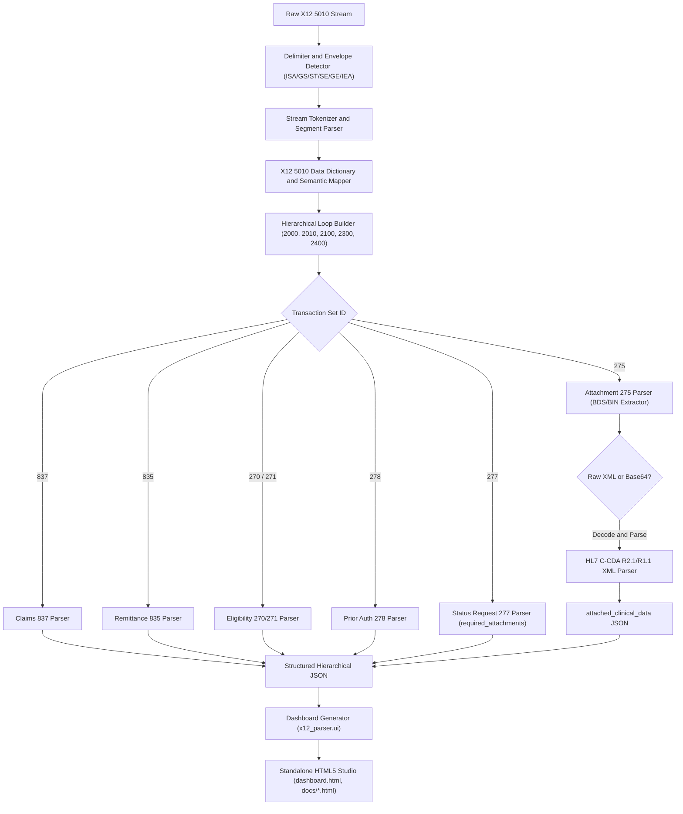

# EDI X12-to-JSON Healthcare Parser and HL7 C-CDA Integration Engine

A zero-dependency, modular ANSI ASC X12 (Version 5010) to structured JSON parser featuring HL7 Consolidated Clinical Document Architecture (C-CDA R2.1 and R1.1) XML payload extraction, semantic healthcare field mapping, standalone interactive HTML5 dashboards (`dashboard.html`), and an HTTP REST and Server-Sent Events (SSE) API service.

---

## 1. Non-Technical User Guide: How to Use This Skill

### What is EDI X12?
Hospitals, medical clinics, pharmacies, billing clearinghouses, and health plans exchange administrative and clinical records using an electronic standard called **EDI X12** (Electronic Data Interchange, Version 5010).

Raw EDI files consist of compact, coded text segments separated by punctuation characters such as asterisks and tildes (for example: `CLM*98124*450.00***11:B:1*Y*A*Y*Y~`). Software systems transmit these files directly, whereas people reviewing claims, payments, or clinical requests normally have to look up code tables to read them.

### What Does This Skill Do?
This skill converts raw healthcare EDI files and attached clinical XML documents into readable summaries, structured JSON records, and interactive web dashboards. Specifically, it:
- Identifies the organizations and individuals involved in a transaction, including clinics, physicians, subscribers, patients, and health plans.
- Extracts claim numbers, billed charges, procedure codes, diagnosis codes, benefit coverage terms, and payment totals.
- Shows whether a claim was approved, paid in full, reduced by contractual adjustments, or pended for review.
- Flags requests for additional medical documentation and decodes attached clinical progress notes, vital signs, medication lists, and allergy records.
- Produces standalone `.html` dashboard files that open directly in any standard web browser without installing extra software.

### Real-World Examples for Non-Technical Users

#### Example 1: Checking Patient Insurance Coverage Before an Appointment (`270` Inquiry and `271` Response)
- **Scenario**: A clinic front-desk coordinator wants to confirm whether a patient's health plan is active and check the office visit copay and annual deductible before a scheduled visit.
- **How to Use**: Open `dashboard.html` in a web browser and select `[271] sample_271_response.x12` from the top dropdown menu (or upload the clinic's `.x12` response file using **Parse X12 Stream**).
- **What You See**:
  - Confirmation of active coverage under the patient's plan (such as Comprehensive Major Medical).
  - Clear dollar and percentage figures for office visit copayments ($25.00), remaining deductibles ($500.00), and coinsurance rates (20%).
  - Verified subscriber demographics, member ID, and date of birth.

#### Example 2: Understanding an Insurance Payment and Write-Off (`835` Remittance Advice)
- **Scenario**: A medical billing specialist receives an electronic payment file (`835`) where the clinic billed $1,500.00, received $950.00 by bank transfer, and needs to know why $550.00 was not paid.
- **How to Use**: Select `[835] sample_835_remittance.x12` in `dashboard.html` (or run `python3 -m x12_parser.cli sample_data/sample_835_remittance.x12 --html docs/dashboard_835_remittance.html` and open the generated file).
- **What You See**:
  - The total payment transferred ($950.00 via ACH) and bank trace number (`CHK78912345`).
  - A side-by-side breakdown of billed charges ($1,500.00), payer payment ($950.00), contractual write-offs ($450.00), and the amount owed by the patient ($100.00 for deductible and coinsurance).
  - Plain-language descriptions for every adjustment reason code instead of raw `CAS` segment codes.

#### Example 3: Finding Out Why a Claim is on Hold (`277` Status Request)
- **Scenario**: A claim has not been paid because the health plan placed it on hold pending additional clinical documentation.
- **How to Use**: Load the `277` file in `dashboard.html` or pass `sample_data/sample_277_request.x12` to the skill.
- **What You See**:
  - A pended claim alert showing the dollar amount on hold ($1,500.00) and the payer's claim control number.
  - The exact type of record requested (for example, `Progress Report`, code `09`).
  - How the clinic should send the record (`Electronic Only`) and the attachment tracking number (`ATT-REF-99214-CCDA`) to include on the response.

#### Example 4: Reading Attached Medical Records (`275` Patient Information with C-CDA XML)
- **Scenario**: A utilization review nurse needs to read the clinical progress note, vital signs, medications, and allergies sent inside an electronic `275` attachment envelope.
- **How to Use**: Open `dashboard.html`, select `[275] sample_275_ccda_response.x12` (or upload a `.x12` attachment file), and click the **C-CDA Clinical Payload** tab.
- **What You See**:
  - **Patient Demographics**: Full name, date of birth, medical record number, address, and phone number.
  - **Allergies**: Recorded allergens, RxNorm codes, reactions, and severity levels (for example, severe anaphylaxis reaction to Penicillin G).
  - **Active Medications**: Current prescriptions, dosages, and schedules (for example, Lisinopril 20 MG once daily).
  - **Diagnoses and Vital Signs**: Active ICD-10 conditions alongside blood pressure, heart rate, oxygen saturation, and weight measurements.
  - **Clinical Notes**: The physician's narrative evaluation explaining medical necessity.

#### Example 5: Exploring Your Own EDI File in the Browser Without Writing Code
1. Open `dashboard.html` from the project root directory in any standard web browser.
2. Click **Parse X12 Stream** in the top navigation bar.
3. Drag and drop an `.x12`, `.edi`, or `.txt` file into the upload area (or paste the raw EDI text) and click **Parse & Update Studio**.
4. Every chart, summary card, clinical view, segment inspector, raw file view, JSON tree, and field mapping table updates immediately to display the uploaded file. Use `Light`, `Dark`, or `System` in the top-right corner to adjust screen contrast, and click **Download .json** on the **Structured JSON** tab to save the converted data.

---

## 2. Supported EDI X12 Transaction Sets (Version 5010)

| Category | Transaction Set | Description | Implementation Guide |
| :--- | :--- | :--- | :--- |
| **Eligibility** | **270** | Health Care Eligibility Benefit Inquiry | `005010X279A1` |
| | **271** | Health Care Eligibility Benefit Response | `005010X279A1` |
| **Prior Authorization** | **278** | Health Care Services Review (Request and Response) | `005010X217` |
| **Claims and Remittance** | **837** | Health Care Claim (Professional and Institutional) | `005010X222A1` / `005010X223A2` |
| | **835** | Health Care Claim Payment and Remittance Advice | `005010X221A1` |
| **Clinical Attachments** | **277** | Health Care Information Status and Documentation Request | `005010X212` / `005010X214` |
| | **275** | Patient Information Attachment Envelope (with HL7 C-CDA) | `005010X210` / `005010X218` |

---

## 3. System Architecture and Processing Pipeline



### Core Engine Capabilities
- **Automatic Delimiter Detection**: Reads element (`*`), component (`:`), repetition (`^`), and segment (`~`) delimiters directly from the 106-character `ISA` header, supporting non-standard custom delimiters while preserving embedded XML payloads inside `BDS`/`BIN` segments.
- **Hierarchical Loop Assembly**: Organizes segments into nested 5010 loop structures (`Loop 1000`, `2000`, `2010`, `2100`, `2300`, `2400`) and `HL` parent-child hierarchies.
- **Semantic Field Mapping**: Translates positional element codes (`BHT02`, `CLM02`, `CLP04`, `SV101`, `STC01`) into descriptive JSON property names and code descriptions.
- **277/275 Clinical Attachment Correlation**: Flags requested clinical documentation on `277` transactions (`required_attachments`) and extracts raw or Base64-encoded HL7 C-CDA XML clinical records from `275` transactions (`attached_clinical_data`).

---

## 4. Project Structure and Directory Tree

All paths below are relative to the project root directory:

```text
.
|-- .gitignore
|-- DESIGN.md                                        # Visual, typographic, theme, and layout specification
|-- LICENSE                                          # Apache 2.0 License
|-- README.md                                        # Project documentation and non-technical user guide
|-- dashboard.html                                   # Standalone multi-transaction interactive HTML5 studio
|-- prd.md                                           # Product Requirements Document
|-- requirements.txt                                 # Optional development dependencies (stdlib core)
|-- setup.py                                         # Python package installation configuration
|-- docs/                                            # Pre-generated standalone transaction dashboards
|   |-- dashboard_271_eligibility.html               # 271 Eligibility Benefit Response dashboard
|   |-- dashboard_275_ccda.html                      # 275 Clinical Attachment and C-CDA dashboard
|   |-- dashboard_277_request.html                   # 277 Claim Status and Attachment Request dashboard
|   |-- dashboard_278_prior_auth.html                # 278 Prior Authorization Review dashboard
|   |-- dashboard_835_remittance.html                # 835 Electronic Remittance Advice dashboard
|   |-- dashboard_837_claim.html                     # 837 Health Care Claim dashboard
|   `-- x12_mapping_dashboard.html                   # Workspace semantic mapping and telemetry dashboard
|-- sample_data/                                     # Synthetic EDI X12 5010 sample transactions
|   |-- __init__.py                                  # Sample file path and reader helpers
|   |-- sample_270_inquiry.x12                       # 270 Eligibility Benefit Inquiry
|   |-- sample_271_response.x12                      # 271 Eligibility Benefit Response
|   |-- sample_275_ccda_response.x12                 # 275 Attachment Envelope with embedded C-CDA XML
|   |-- sample_277_request.x12                       # 277 Claim Status Request flagging required records
|   |-- sample_278_prior_auth.x12                    # 278 Prior Authorization Request and Certification
|   |-- sample_835_remittance.x12                    # 835 Remittance Advice with CARC/RARC adjustments
|   `-- sample_837_claim.x12                         # 837 Professional Health Care Claim
|-- scripts/                                         # Project utility scripts
|   `-- copy_to_local.sh                             # Relative-path synchronization and tarball helper
|-- skills/                                          # Agent skill definitions and references
|   `-- x12-healthcare-parser/
|       |-- SKILL.md                                 # Skill workflow and dashboard generation guide
|       |-- examples/
|       |   `-- parse_and_visualize_example.py       # End-to-end Python parsing and dashboard example
|       |-- references/
|       |   |-- visual_dashboard_guide.md            # Dashboard architecture and token reference
|       |   `-- x12_json_mapping_specs.md            # Field-by-field X12 5010 to JSON mapping reference
|       `-- scripts/
|           `-- generate_visual_dashboard.py         # CLI helper for generating HTML dashboards
|-- tests/                                           # Automated unit and integration test suite (25 tests)
|   |-- run_all_tests.py                             # Test suite runner and summary reporter
|   |-- test_277_attachment_request.py               # 277 status category and PWK attachment flag tests
|   |-- test_api_and_manifests.py                    # REST API, SSE stream, manifest, and DESIGN.md tests
|   |-- test_ccda_extraction.py                      # 275 raw XML and Base64 C-CDA extraction tests
|   |-- test_data_integrity.py                       # 837, 835, 270, 271, and 278 semantic mapping tests
|   `-- test_engine_structure.py                     # Delimiter detection, custom separators, envelope tests
`-- x12_parser/                                      # Core Python package
    |-- __init__.py                                  # Public package exports
    |-- cli.py                                       # Command-line interface (--summary, --pretty, --html)
    |-- api/                                         # HTTP REST and SSE server + OpenAPI schemas
    |   |-- openapi.json                             # OpenAPI 3.1.0 specification (JSON)
    |   |-- openapi.yaml                             # OpenAPI 3.1.0 specification (YAML)
    |   `-- server.py                                # Multi-threaded HTTP and SSE server
    |-- clinical_parsers/                            # Clinical XML extractors
    |   |-- __init__.py
    |   `-- ccda_parser.py                           # HL7 C-CDA R2.1 and R1.1 XML parser
    |-- engine/                                      # Core X12 tokenization and loop assembly engine
    |   |-- __init__.py
    |   |-- base_parser.py                           # Master X12Parser orchestrator
    |   |-- dictionary.py                            # 5010 segment, element, and qualifier dictionary
    |   |-- loop_builder.py                          # Hierarchical loop tree builder
    |   |-- segment_parser.py                        # Segment and composite sub-element parser
    |   `-- tokenizer.py                             # ISA delimiter detector and stream tokenizer
    |-- manifests/                                   # Plugin and skill manifests
    |   |-- ai-plugin.json                           # AI plugin manifest
    |   `-- skill-manifest.json                      # Skill manifest and dashboard configuration
    |-- transaction_parsers/                         # Specialized X12 5010 transaction handlers
    |   |-- __init__.py
    |   |-- attachment_275.py                        # 275 Attachment Envelope and BDS/BIN parser
    |   |-- claims_837.py                            # 837 Professional and Institutional Claim parser
    |   |-- eligibility_270_271.py                   # 270 Inquiry and 271 Benefit Response parser
    |   |-- prior_auth_278.py                        # 278 Services Review and Prior Auth parser
    |   |-- remittance_835.py                        # 835 Electronic Remittance Advice parser
    |   `-- status_request_277.py                    # 277 Claim Status and Attachment Request parser
    `-- ui/                                          # Interactive HTML5 dashboard generator
        |-- dashboard_generator.py                   # Self-contained HTML/CSS/JS studio generator
        `-- x12_mapping_dashboard.html               # Generated default mapping studio bundle
```

---

## 5. Technical Usage and Quickstart

### Python Library API

```python
from x12_parser import X12Parser
from sample_data import read_sample

raw_x12 = read_sample("sample_837_claim.x12")

# Parse X12 5010 content into a structured Python dictionary
parsed = X12Parser.parse(raw_x12)
print(parsed["summary"])
print(parsed["functional_groups"][0]["transaction_sets"][0]["parsed_transaction"])

# Generate a standalone interactive HTML5 dashboard
X12Parser.generate_dashboard(
    parsed,
    output_path="docs/dashboard_837_claim.html",
    raw_x12=raw_x12,
    title="Dashboard - Sample 837 Claim"
)
```

### Command-Line Interface (CLI)

```bash
# Print a structured ASCII summary of transaction sets
python3 -m x12_parser.cli sample_data/sample_837_claim.x12 --summary

# Parse an X12 file and generate an interactive HTML dashboard
python3 -m x12_parser.cli sample_data/sample_837_claim.x12 --html docs/dashboard_837_claim.html

# Regenerate the root multi-dataset dashboard.html bundle
python3 -m x12_parser.ui.dashboard_generator dashboard.html

# Write formatted JSON output to a relative path
python3 -m x12_parser.cli sample_data/sample_275_ccda_response.x12 -o dist/output_275.json --pretty

# Read raw X12 directly from standard input
cat sample_data/sample_835_remittance.x12 | python3 -m x12_parser.cli - --summary
```

### HTTP REST and SSE Streaming Server

```bash
# Start server on port 8000
python3 -m x12_parser.api.server 8000
```

Available HTTP endpoints:
- `GET /dashboard`: Serves `dashboard.html`.
- `GET /v1/events`: Server-Sent Events (`text/event-stream`) broadcasting live `parse_update` records to connected dashboards.
- `POST /v1/parse/x12`: Parses raw EDI X12 submitted as `application/json` (`{"raw_x12": "..."}`) or `text/plain`. Supports `?format=html` for HTML dashboard output and `?include_telemetry=1` for telemetry-enriched dataset records.
- `GET /v1/health`: Service health status JSON.
- `GET /openapi.json`: OpenAPI 3.1.0 specification.
- `GET /.well-known/ai-plugin.json`: Plugin manifest.
- `GET /skill-manifest.json`: Skill manifest.

---

## 6. Running the Automated Test Suite

Run all 25 unit and integration tests from the project root directory:

```bash
PYTHONDONTWRITEBYTECODE=1 python3 tests/run_all_tests.py
```

Expected output summary:
```text
======================================================================
RUNNING X12 HEALTHCARE PARSER & C-CDA TEST SUITE
======================================================================
Ran 25 tests in ...s

OK

======================================================================
TEST SUITE EXECUTION SUMMARY
======================================================================
Total Tests Executed: 25
Passed:               25
Failures:             0
Errors:               0
======================================================================
```
